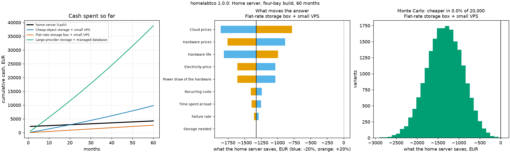

# tco: what a home server really costs against the cloud, with the uncertainty shown

[](https://github.com/TexAlphaWolf/ana-homelab-tco/actions/workflows/ci.yml)
[](https://github.com/TexAlphaWolf/ana-homelab-tco/actions/workflows/codeql.yml)


A total-cost-of-ownership calculator for a home server. You describe the hardware (price, life, idle and load watts, failure rate),
the electricity tariff by hour of the day, and what the same job would cost in the cloud; it gives the monthly cash cost, the
break-even month, which assumptions move the answer most, and **how often the home server wins when every assumption is
uncertain**. The cost model is vectorised, and a second implementation that **walks the calendar day by day and hour by hour**
checks it. A command line (`tco`) with tests, a Docker image and reports generated from the numbers.



## What the numbers say

The example scenario ([`docs/report.json`](docs/report.json)) is a four-bay server of €2,230 against three ways of renting
the same thing, over 60 months. **Every price in it is an assumption** to replace with your own; the point is what
the model does with them. Speed figures are from one run in Docker on Linux x86_64 with 12 CPUs, Python 3.14.10 and NumPy 2.5.4
([`docs/bench.json`](docs/bench.json); medians of 5 runs).

1. **The home server costs €4,258 in cash over 60 months**: €2,230 of hardware, €1,429 of
   electricity, €178 of expected spares and €420 of recurring costs. Net of €236 of hardware
   still worth something at the end it is €4,021, €67 a month, at an average draw of 103 W.
2. **Against cheap object storage and a small VPS (€164 a month) it saves €5,789** and breaks even
   in month 21 (2027-09). With every group of numbers drawn at random it is cheaper in 100.0% of
   20,000 variants (5th to 95th percentile of the saving: €3,411 to €8,352).
3. **A flat-rate storage box (€45 a month) is cheaper than owning**: the home server costs €1,321 more,
   never breaks even in 60 months and wins in 3 of 20,000 variants. A result that goes against the home server is a result.
4. **Against a large provider with a managed database it saves €34,814**, with break-even in month 5.
5. **The cloud price and the amount of storage decide it, electricity does not.** Moving each group 20% either way changes the saving
   against the cheap object storage by €3,924 (cloud prices) and €3,444 (storage needed), against €869
   (hardware prices) and €572 (electricity price).
6. **Your time is the hidden cost.** The example counts 3 hours a month of administration at no value; valued at more than
   €32 an hour the home server stops beating the cheap object storage.
7. **Speed.** 1,000,000 Monte Carlo variants of the whole scenario take 5.86 s (170,565 variants a second), about
   1,785 times faster than the literal simulation would take; the two agree to 1.46e-14 on 51 comparisons.

[`docs/analysis.md`](docs/analysis.md) goes through the results and their limits; [`docs/report.md`](docs/report.md) and
[`docs/bench.md`](docs/bench.md) are the generated reports; [`docs/method.md`](docs/method.md) defines every cost.

## Quick start

With Docker (nothing else to install):

```bash
docker build -t tco .
docker volume create tcov
docker run --rm --user 0 -v tcov:/data --entrypoint chown tco 10001 /data
RUN="docker run --rm --read-only --tmpfs /tmp --cap-drop ALL --security-opt no-new-privileges --network none -v tcov:/data tco"
$RUN example -o /data/home.yaml                 # the bundled scenario: edit it
$RUN run /data/home.yaml --out /data/out        # report.json, report.md, summary.png
```

With Python 3.11 to 3.14:

```bash
pip install .
tco example -o home.yaml                        # then put your own numbers in it
tco run home.yaml --out out
tco verify home.yaml                            # model against the literal simulation
```

## Real output

`tco run` on the bundled example:

```text
Home server, four-bay build: 60 months from 2026-01
home server: cash €4,258, residual value €236, net €4,021 (€67 a month)
Cheap object storage + small VPS: cloud €9,810; home server saves €5,789; break-even month 21 (2027-09)
Flat-rate storage box + small VPS: cloud €2,700; home server saves -€1,321; no break-even
Large-provider storage + managed database: cloud €38,835; home server saves €34,814; break-even month 5 (2026-05)
```

## The scenario file

A YAML file, checked when it is read (a typo is an error that names the field, such as `hardware[2].life_months`):

| Section | What it holds |
|---|---|
| `start`, `horizon_months` | The first calendar month and how many months to look at |
| `electricity` | Price per kWh (one number or 24, one per hour of the day), yearly increase, overhead factor for power-supply losses |
| `load` | Share of each hour spent at load power (one number or 24) |
| `hardware` | Each part: price, count, life in months, idle and load watts, annual failure rate |
| `recurring`, `admin` | Monthly costs; hours of administration a month and what an hour is worth to you |
| `cloud` | Alternatives, each a list of `fixed`, `storage` (TB, yearly growth, price per TB-month) and `egress` items; yearly price increase |
| `uncertainty` | How far each group of numbers may be off, for the Monte Carlo run |

## Commands

| Command | What it does |
|---|---|
| `tco example [-o FILE]` | Prints (or writes) the bundled scenario |
| `tco validate [FILE]` | Checks a scenario file |
| `tco run [FILE] [--samples N] [--seed S] [--swing X] [--out DIR]` | Costs, break-even, sensitivity and Monte Carlo; writes `report.json`, `report.md`, `summary.png` |
| `tco verify [FILE] [--draws N]` | Compares the model with the literal simulation; exit 1 on a difference |
| `tco bench [FILE] [--sizes A,B,C] [--repeat R] [--draws N] [--out DIR]` | Speed of the model and agreement with the literal simulation |
| `tco render FILE.json [-o FILE.md] [--figure FILE.png]` | Rebuilds the Markdown (and figure) from a `report.json` or `bench.json` |

Without a FILE the bundled example is used. Exit codes: 0 success, 1 a verification mismatch, 2 an error (invalid file, bad options).

## How the model is checked

[`reference.py`](src/homelabtco/reference.py) computes the same costs with no arrays and no closed forms: it loops over the months of the
calendar, each day of each month and each of the 24 hours for the energy, and walks forward in time to buy hardware. `tco verify`
compares it with the vectorised model on the scenario and on random variants; the tests do it on randomly generated scenarios too, and
show the check can fail (a model 0.1% off, or a wrong break-even month, is reported).

## Development

```bash
pip install -e ".[dev]"
ruff check . && ruff format --check . && mypy && pytest --cov
```

CI runs this on Python 3.11 to 3.14, again with more random variants and another seed, on Windows and macOS, builds the Docker image
and runs the end-to-end scripts (`tools/docker_e2e.sh`, and `tools/docker_e2e.ps1` from PowerShell). `tools/run_full.ps1` produces the speed
measurements in this README.

## Limits

Every price is an assumption you supply; the home server's capacity is fixed; straight-line life and cash purchases; no tax, discounting or
price of downtime; Monte Carlo groups are independent. See [`docs/limitations.md`](docs/limitations.md).

MIT license.
